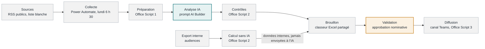

# Veille médias hebdomadaire avec Power Automate

Un flux Power Automate qui prépare chaque lundi un brouillon de synthèse des tendances médias à partir de sources publiques et d’un export interne, avec une IA limitée à une seule tâche et une validation humaine obligatoire avant toute diffusion.

> Cas pratique réalisé dans le cadre d’un processus de recrutement. Toutes les données sont fictives : chaînes, programmes, sources et chiffres sont inventés.

**Principe : automatiser la préparation, pas la décision éditoriale.** L’IA propose, l’équipe décide, et rien n’est diffusé sans approbation nominative. Quand une règle fixe suffit, aucune IA n’est utilisée.

## Fonctionnement



1. **Collecte.** Le connecteur RSS lit chaque source de la liste blanche, avec trois tentatives. Une source en panne déclenche une alerte Teams.
2. **Préparation (Office Script 1).** Il garde les sept derniers jours, retire les mots exclus, regroupe les doublons par l’URL nettoyée ou le titre et repère les chiffres qui diffèrent d’une source à l’autre.
3. **Analyse IA.** Le prompt ne reçoit que le titre, l’extrait, la date et la source. Il propose une catégorie, un résumé de deux phrases maximum et les points à vérifier. Il n’invente rien et écrit « non précisé » quand une information manque.
4. **Contrôles (Office Script 2).** Chaque chiffre et chaque nom propre du résumé doivent exister dans la source. Les textes contenant une consigne cachée sont écartés. Les audiences internes sont calculées par formule, sans IA.
5. **Validation et diffusion (Office Script 3).** Le responsable corrige le brouillon dans Excel, puis approuve depuis Teams ou Outlook. La version validée, avec son nom, est publiée dans le canal de l’équipe et une ligne s’ajoute au suivi du pilote.

## Tester

| Durée | Comment | Prérequis |
|---|---|---|
| 2 minutes | Ouvrir [`demo/index.html`](demo/index.html) dans un navigateur. La page exécute les trois scripts sur les données fictives. | Aucun |
| 5 minutes | Lancer `npm test` à la racine du dépôt. Les scripts sont compilés en TypeScript strict, puis cinq scénarios et douze vérifications s’exécutent. | Node.js 18 ou plus récent |
| 45 minutes | Monter le flux en suivant la [fiche de montage](power-automate/fiche_de_montage.md), en 16 actions. | Microsoft 365 avec Power Automate |

Le [guide de test](docs/guide_de_test.pdf) détaille chaque étape et les résultats attendus. Les tests sont aussi relancés automatiquement par GitHub Actions à chaque modification du dépôt.

```bash
npm test
```

## Structure du dépôt

```
veille-medias-power-automate/
├── README.md
├── package.json                    commande « npm test »
├── .github/workflows/tests.yml     tests automatiques sur GitHub
├── demo/
│   └── index.html                  démonstration dans le navigateur
├── office-scripts/                 la logique du flux, à coller dans Excel (onglet Automatiser)
│   ├── 1_Preparer.ts               période, mots exclus, doublons, chiffres divergents
│   ├── 2_Controler.ts              contrôles de la réponse IA, audiences sans IA, brouillon
│   └── 3_Publier.ts                version validée, nom obligatoire, ligne de suivi
├── power-automate/
│   ├── fiche_de_montage.md         les 16 actions du flux et leurs réglages
│   ├── prompt_ai_builder.txt       consigne envoyée à l’IA
│   └── exemple_elements.json       entrée d’exemple pour tester le prompt
├── excel/
│   └── Synthese_hebdo_medias.xlsx  classeur partagé : paramètres, sources, audiences, brouillon, suivi
├── tests/
│   ├── lancer_les_tests.js         compile les scripts, lance les scénarios, vérifie les résultats
│   ├── test.js                     faux classeur et cinq scénarios
│   ├── excelscript.d.ts            méthodes Excel utilisées, mêmes signatures que l’API Office Scripts
│   └── fixtures/                   données fictives et réponses IA simulées
└── docs/
    ├── rapport_cas_pratique.pdf    rapport de trois pages
    ├── guide_de_test.pdf           guide de test
    ├── exemples/                   brouillon et synthèse validée produits par les scripts
    └── latex/                      sources LaTeX du rapport et du guide
```

## Choix techniques

- **Rester dans les outils déjà en place.** Power Automate et des connecteurs standard : RSS, Excel Online (Business), Approbations et Teams.
- **Une seule étape d’IA, encadrée.** Le prompt ne reçoit que des contenus publics, et sa réponse est contrôlée avant d’être relue par une personne.
- **Deux circuits de données séparés.** Les audiences internes arrivent par un export Excel et ne passent jamais par l’IA.
- **Pas de connecteur premium pour l’API interne en V1.** Le connecteur HTTP est premium, donc un export régulier sert de solution de repli.
- **Traçabilité.** Chaque élément garde sa source, son lien, son extrait d’origine et son statut (« à arbitrer », « à confirmer », « écarté »).

## Limites

- Dans la démonstration et les tests, la réponse de l’IA provient de réponses préparées au format demandé par le prompt.
- Le flux n’a pas été monté dans un environnement Microsoft 365. Les noms exacts des champs dynamiques, les licences et les crédits AI Builder ou Copilot restent à confirmer.
- Les contrôles repèrent un chiffre ou un nom inventé, pas un fait mal reformulé avec des mots. La relecture humaine reste obligatoire.

## Utilisation de l’IA

Des IA génératives (Claude et ChatGPT) ont aidé à structurer les pistes, clarifier certains choix techniques, écrire les Office Scripts et les tester avec des données fictives. Les arbitrages présentés sont ceux de l’autrice.

## Autrice

Meriem Sohbi, M2 Data & IA, Université Paris Cité.
